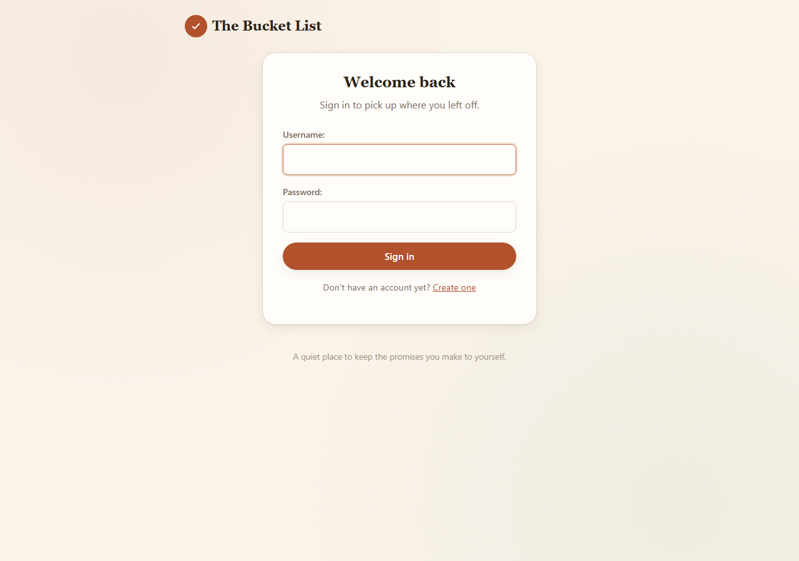
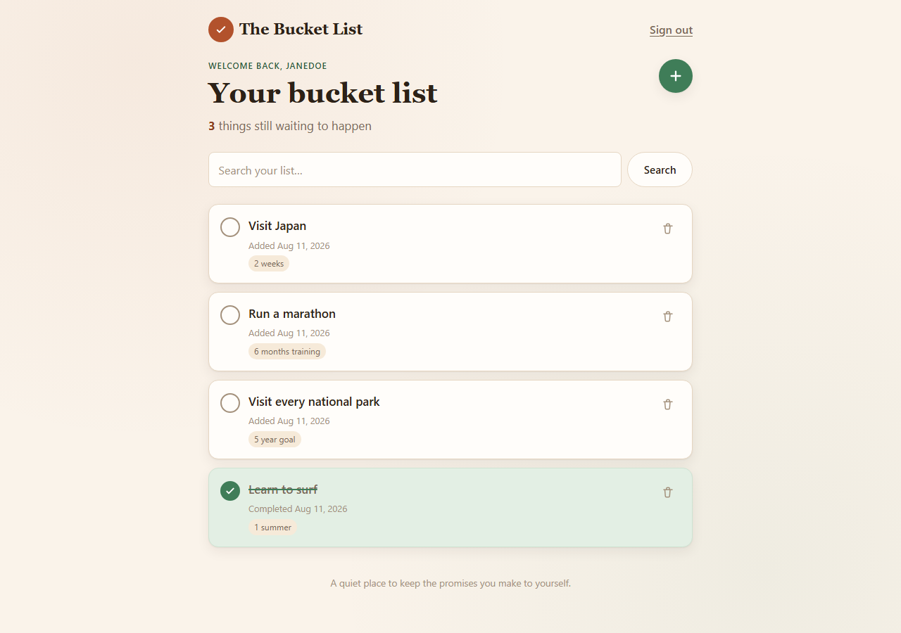
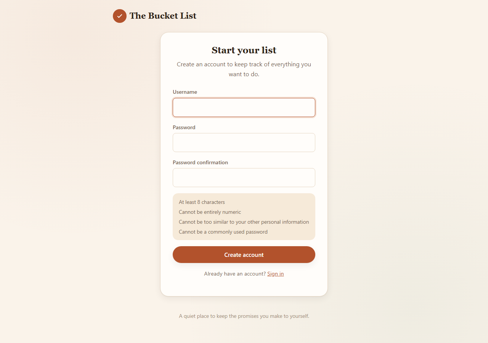

# The Bucket List

A personal bucket-list and to-do tracker built with Django. Sign in, write
down the things you want to do, see, or become, and check them off as you
get there. Each completed item is timestamped, so the list doubles as a
quiet record of promises you kept to yourself.





## Features

- Account registration and authentication (Django's built-in auth system)
- Per-user lists — everyone only sees their own items
- Create, edit, and delete list items
- Mark items complete, with an automatically recorded completion date
- Search across your list
- A count of how many items are still outstanding
- Clean empty and no-results states
- Fully responsive layout, hand-written CSS, no external frameworks or CDNs
- Visible keyboard focus states and semantic form markup for accessibility

## Tech stack

- **Backend:** Django 4.2 (Python)
- **Database:** SQLite for local development (swap `DATABASES` for Postgres
  in production if needed)
- **Frontend:** Server-rendered Django templates, hand-authored vanilla CSS
  (no Bootstrap, Tailwind, or other frameworks/CDNs — the app renders
  correctly with no internet connection)
- **Static files in production:** WhiteNoise
- **App server:** Gunicorn

## Screenshots

Screenshots live in [`assets/screenshots`](assets/screenshots): the sign-in
page, the registration page, and the bucket list itself with a mix of open
and completed items.

## Local setup

### Requirements

- Python 3.11+ (the project also runs on Python 3.10–3.12)
- pip

### 1. Clone and enter the project

```bash
git clone https://github.com/Jenks00/Bucketlist.git
cd Bucketlist
```

### 2. Create and activate a virtual environment

```bash
python -m venv venv
# macOS/Linux
source venv/bin/activate
# Windows
venv\Scripts\activate
```

### 3. Install dependencies

```bash
pip install -r requirements.txt
```

### 4. Configure environment variables

Copy the example environment file and adjust as needed:

```bash
cp .env.example .env
```

Then set `DJANGO_SECRET_KEY`, `DJANGO_DEBUG`, and `DJANGO_ALLOWED_HOSTS`. In
local development you can leave `DJANGO_DEBUG=True` and the defaults will
work out of the box. `manage.py` does not load `.env` automatically — either
export the variables in your shell before running the server, or use a tool
such as `django-environ` or `python-dotenv` if you would like automatic
loading.

### 5. Apply database migrations

```bash
python manage.py migrate
```

### 6. Create an admin user (optional)

```bash
python manage.py createsuperuser
```

### 7. Run the development server

```bash
python manage.py runserver
```

Visit `http://127.0.0.1:8000/` and register an account to get started.

## Project structure

```
Bucketlist/
├── bucketlistprj/        # Django project settings, URLs, WSGI/ASGI entry points
├── bucket_list/           # The bucket-list app: models, views, templates, static assets
│   ├── migrations/
│   ├── static/bucket_list/css/style.css
│   ├── templates/bucket_list/
│   ├── models.py
│   ├── views.py
│   └── urls.py
├── assets/screenshots/    # Screenshots used in this README
├── manage.py
├── requirements.txt
├── Procfile
└── .env.example
```

## Deployment

The project is ready to deploy to any Heroku-style platform (Heroku,
Railway, Render, etc.) with no additional configuration:

- **`Procfile`** declares the web process: `web: gunicorn bucketlistprj.wsgi`
- **WhiteNoise** is wired into `MIDDLEWARE` and `STATICFILES_STORAGE` in
  `settings.py`, so static files are served correctly in production without
  a separate static file host or CDN
- **Settings are environment-driven**: `SECRET_KEY`, `DEBUG`, and
  `ALLOWED_HOSTS` are all read from environment variables
  (`DJANGO_SECRET_KEY`, `DJANGO_DEBUG`, `DJANGO_ALLOWED_HOSTS`), with safe
  local-development defaults when they are not set

To deploy:

1. Provision the app on your platform of choice and connect this
   repository.
2. Set the environment variables from `.env.example` in the platform's
   dashboard, using a freshly generated `DJANGO_SECRET_KEY` and
   `DJANGO_DEBUG=False`.
3. Set `DJANGO_ALLOWED_HOSTS` to the domain(s) the app will be served from.
4. Run `python manage.py migrate` and `python manage.py collectstatic` as a
   release/build step (most platforms run these automatically when they
   detect a Django project, or you can add them to a build script).
5. Deploy. The `Procfile` will start the app with Gunicorn.

For a persistent database in production, swap the SQLite configuration in
`bucketlistprj/settings.py` for a managed Postgres (or similar) database,
typically by reading a `DATABASE_URL` environment variable.

## License

Released under the [MIT License](LICENSE).
